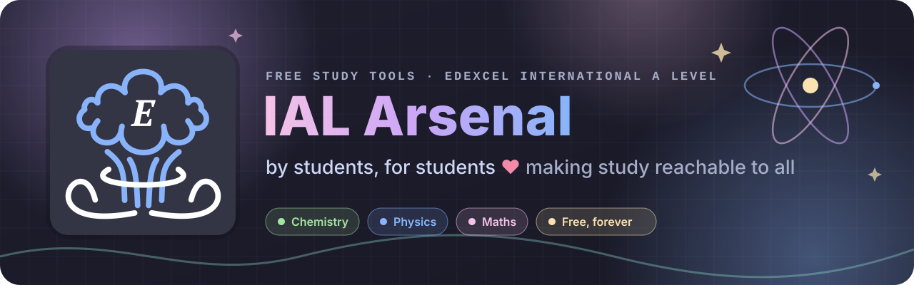
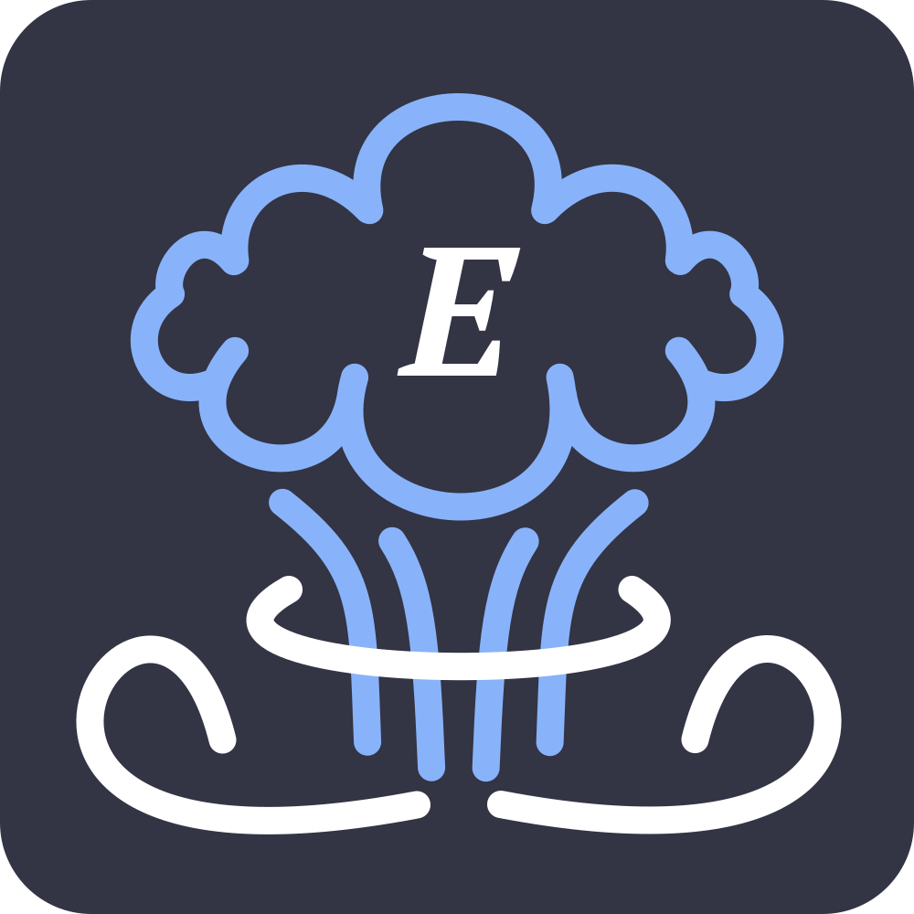

<p align="center">
  <a href="https://ial-arsenal.thecodeheist.is-a.dev">
    
  </a>
</p>

<p align="center">
  <b>Free, open-source study tools for Edexcel International A Level.</b><br>
  <i>By students, for students. Making study reachable to all.</i>
</p>

<p align="center">
  <a href="https://ial-arsenal.thecodeheist.is-a.dev"><b>🌐 Open the site</b></a> ·
  <a href="#-whats-inside">🧪 What's inside</a> ·
  <a href="#-run-it-yourself">🛠️ Run it</a> ·
  <a href="#-credits--thank-yous">💐 Credits</a> ·
  <a href="#-come-build-with-us">🤝 Contribute</a>
</p>

<p align="center">
  
  
  
  
  
</p>

---

## 👋 Hey there!

Ever stared at a page of transition-metal colours and thought *"there's no way I'm memorising all that"*? Or read about a cyclotron three times and still couldn't picture it? Same. That's how this place started.

**Edexcel IAL Arsenal** is a hobby project: a growing pile of interactive labs, drills and past-paper tools for Pearson Edexcel International A Level students. You don't just read about a reaction, you *run* it. You don't just learn SUVAT, you fire a cannon off a cliff and watch it happen. Then the past-paper section lets you practise on the real questions, sorted by topic.

Everything runs in your browser. No sign-ups, no ads, no paywalls, no "unlock premium to see the answer". Your scores and theme stay on your own device. Just open it and start learning. ✨

> **Why?** Good revision resources shouldn't depend on where you live or what you can pay. Lots of IAL students study on their own, often with patchy access to labs, tutors or decent materials. If a free website can stand in for some of that, it should exist. So here it is. 💛

---

## 🧪 What's inside

### ⚗️ Chemistry

| | Tool | What you do |
|---|---|---|
| 🧫 | **[d-Block Colour Bench](https://ial-arsenal.thecodeheist.is-a.dev/chemistry/d-block-colour-bench/)** | Drop reagents onto transition-metal ions on a white tile and watch the precipitates, colour changes and complexes form. Then try to identify the mystery ions. *(WCH15, WCH16)* |
| 🔮 | **[Carbon Alchemy](https://ial-arsenal.thecodeheist.is-a.dev/chemistry/carbon-alchemy/)** | Organic chemistry as a transmutation circle. Combine compounds and reagents to discover reactions, plan synthesis routes, run identification tests and fill in your codex. *(WCH15, WCH16)* |

### ⚡ Physics

| | Tool | What you do |
|---|---|---|
| 🔌 | **[Circuit Builder](https://ial-arsenal.thecodeheist.is-a.dev/physics/circuit-builder/)** | Wire up cells, lamps, diodes, sensors and capacitors on a live board and watch the charge flow. Predict meter readings, plot I–V curves and time a capacitor discharge. *(WPH12, 13, 14, 16)* |
| 🎯 | **[Projectile Lab](https://ial-arsenal.thecodeheist.is-a.dev/physics/projectile-lab/)** | Launch things off the ground or a cliff with strobe images, shadows and velocity components, answer exam-style questions drawn to scale, and land shots on targets. *(WPH11)* |
| 🌟 | **[Star Lab](https://ial-arsenal.thecodeheist.is-a.dev/physics/star-lab/)** | Follow a star of any mass in 3D, from nebula to white dwarf, neutron star or black hole, with its path traced on the HR diagram. Then eclipse some binaries and climb the distance ladder. *(WPH15)* |
| ⚛️ | **[Particle Lab](https://ial-arsenal.thecodeheist.is-a.dev/physics/particle-lab/)** | Accelerate particles in a linac and a cyclotron, read cloud and bubble chamber tracks, fire α particles at gold, build hadrons from quarks and check reactions against the conservation laws. *(WPH14)* |

### 📚 Past papers

A searchable library of real Edexcel IAL past-paper questions, cut out question by question with their mark schemes:

- 🗂️ **Browse by paper** or **by topic**: every question tagged to the bit of the spec it tests.
- 📝 **Build a mock paper** from questions you choose, then download it as a PDF.
- 🔗 **Every question links back to its source**, with credit to the archive it came from (see [credits](#-credits--thank-yous)).
- 📈 **Coverage**: Physics is live, Maths (Pure, Further Pure, Mechanics, Statistics, Decision) is landing in batches, and Chemistry is next.

### 🎨 And the little things

- **Six colour themes** (Catppuccin, Tokyo Night, Nord, Rosé Pine, Gruvbox and Everforest), each with light and dark modes. Pick one once and every tool follows it.
- **Edexcel spellings and notation** throughout: sulfur, aluminium, colourless, the works.
- **Works on your phone**, because let's be honest, that's where most revision happens.

### 🌱 Coming soon™

More Physics labs, revision notes, Chemistry past papers, and hopefully **Biology**, once someone who actually survived it joins in (hint hint 👀).

---

## 🛠️ Run it yourself

You'll need [Node.js](https://nodejs.org) and [pnpm](https://pnpm.io).

```sh
git clone https://github.com/TheCodeHeist/edexcel-ial-arsenal.git
cd edexcel-ial-arsenal
pnpm install
pnpm dev        # 🚀 http://localhost:4321
```

Other handy commands:

```sh
pnpm check      # astro check + svelte-check
pnpm build      # check, then build to dist/ (run this before pushing: warnings fail the deploy)
pnpm preview    # serve the built dist/
```

The past-paper pipeline (the Python scripts that turn PDFs into the question library) lives in [`pipeline/`](pipeline/README.md) and has its own README. You don't need it to work on the site.

---

## 🗺️ Finding your way around

| Path | What lives there |
|---|---|
| `src/data/` | Tools, subjects, units and palettes. **`tools.ts` lists every tool**, and the cards, subject pages, unit maps and stats all read from it |
| `src/styles/` | The design system as CSS: `tokens` → `base` → `controls` → `motion`, then `hub.css` (hub pages) or `sim.css` (simulation building blocks) |
| `src/lib/` | Shared TypeScript: `theme` (palette engine), `motion` (sliding indicators, crossfades, staggers, glint), `chem` (formula formatting), `molecule` (SMILES → SVG), `papers`, `util`, `persist.svelte` (scores saved to the browser) |
| `src/components/ui/` | Shared Svelte bits: `SimHeader`, `StatusLine`, `ThemePicker`, `Seg`, `SubTabs`, `FilterRow`, `SearchInput`, `QuizBox`, `CopyButton`, `Flowchart`, `BottomDrawer` |
| `src/components/` | Hub components (`ToolCard`, `ToolFinder`, `Art`) and the past-paper components in `papers/` |
| `src/layouts/` | `Base.astro` (hub pages) and `Sim.astro` (simulation pages) |
| `src/sims/<name>/` | One folder per simulation: `data.ts` (pure science data), state (`*.svelte.ts`), Svelte views and its own CSS |
| `src/pages/` | Routes: `/`, `/[subject]/`, `/about/`, `/papers/…`, and one page per tool under `/chemistry/` and `/physics/` |
| `registry/` | The past-paper registry: sources, topics, and per-paper question data |
| `pipeline/` | Offline Python tools that build the registry from PDFs |
| `design-system/` | The original design-system export and brand book (`DESIGN.md`, `PALETTES.md`) |

### ✏️ Adding a new simulation

1. Make `src/sims/<name>/` with `data.ts`, an `App.svelte` that renders `SimHeader` + `StatusLine` + its views, and `<name>.css` for its own layout.
2. Add `src/pages/<subject>/<slug>.astro`:
   ```astro
   ---
   import Sim from '../../layouts/Sim.astro';
   import App from '../../sims/<name>/App.svelte';
   import '../../sims/<name>/<name>.css';
   ---
   <Sim title="…" description="…"><App client:only="svelte" /></Sim>
   ```
3. Add an entry to `src/data/tools.ts`. That's it: the card, subject page and unit map pick it up automatically. 🎉

Reach for `src/components/ui/` and the classes in `sim.css` before inventing new ones (design book §1.4).

### 🎨 Theming

One theme for the whole site. The palette and mode are saved in `localStorage` as `arsenal-palette` / `arsenal-mode` (JSON strings), and the hub and every simulation read and write the same keys. Every colour is a CSS variable (`var(--accent)` and friends), so please never hard-code a hex.

---

## 🤝 Come build with us

This is a student project and it's always happy to have more hands. Some ways to help:

- 🐛 **Spotted a mistake?** A wrong colour, a dodgy mark scheme crop, a physics bug? [Open an issue](https://github.com/TheCodeHeist/edexcel-ial-arsenal/issues). Accuracy matters a lot here, so every report helps.
- 🧬 **Took Biology?** We'd love a co-maintainer for that side. Nobody here has taken it, and we'd rather not guess.
- 💡 **Got an idea for a tool?** Whatever topic made you want to throw your textbook, tell us about it.
- 🔧 **Want to code?** Fork it, branch it, send a pull request. New tools, fixes and polish are all welcome.

---

## 💐 Credits & thank-yous

None of this would be possible without a lot of generous people and projects. Here they are, with gratitude:

### 📄 Past papers: the real heroes

The past-paper tools simply would not exist without these two:

- **[PaperLords](https://www.paperlords.org/ial)**: the bulk of our papers and mark schemes come from their archive. They've gathered every IAL series, subject and unit into one tidy, free collection for students everywhere, and they keep it up to date year after year. That's an insane amount of hard work, and it's what made our question library possible. Thank you, truly. 🙏💛
- **[Physics & Maths Tutor](https://www.physicsandmathstutor.com/)**: some of our papers come from their archive, especially the older IAL specifications, and their copies are our backup when a file goes missing. Years of patient collecting that countless students lean on. Thank you! 🙏💛

We collected the papers from their public archives ourselves. They didn't hand them to us, and nothing here means they endorse this project. Every paper page on the site names which archive it came from and links back to it, so please go show them some love. If you run one of these archives and want something credited differently or taken down, [open an issue](https://github.com/TheCodeHeist/edexcel-ial-arsenal/issues) and we'll sort it out quickly.

### 🧰 Built with

- **[Astro](https://astro.build)** builds the site, **[Svelte 5](https://svelte.dev)** powers every interactive bit, and **[TypeScript](https://www.typescriptlang.org)** keeps it all in check.
- **[three.js](https://threejs.org)** draws the 3D in Star Lab and Particle Lab.
- **[pdf-lib](https://pdf-lib.js.org)** turns your mock papers into downloadable PDFs.
- The past-paper pipeline relies on the Python open-source ecosystem (see [`pipeline/requirements.txt`](pipeline/requirements.txt)), and some topic tagging was drafted with help from AI models.

### 🎨 Looks and feel

- **A few small Pearson Edexcel-style touches** appear here and there, so things feel familiar to IAL students. Those styles are Pearson's, and we don't own or claim them in any way.
- **Palettes** are adapted from much-loved community colour schemes: **[Catppuccin](https://catppuccin.com)**, **[Tokyo Night](https://github.com/folke/tokyonight.nvim)**, **[Nord](https://www.nordtheme.com)**, **[Rosé Pine](https://rosepinetheme.com)**, **[Gruvbox](https://github.com/morhetz/gruvbox)** and **[Everforest](https://github.com/sainnhe/everforest)**, and mapped onto our own colour tokens. Huge thanks to their creators and communities.
- **Typefaces** are **[Geist](https://vercel.com/font)**, **[PT Serif](https://fonts.google.com/specimen/PT+Serif)** and **[JetBrains Mono](https://www.jetbrains.com/lp/mono/)**, all open-licence fonts served by [Google Fonts](https://fonts.google.com).
- **Badges** in this README come from [Shields.io](https://shields.io).

### ☁️ Hosting

- The site is hosted on **[Vercel](https://vercel.com)**, and the past-paper images are served by **[GitHub Pages](https://pages.github.com)**.
- The domain comes from **[is-a.dev](https://is-a.dev)**, which gives developers free subdomains.

### ⚠️ Not affiliated. Please read!

**Edexcel IAL Arsenal is an independent, non-commercial student project.** We are **not affiliated with, endorsed by, sponsored by or otherwise officially connected to** **Pearson Edexcel** in any way whatsoever. Nor are we affiliated with any of the projects or people credited above: **PaperLords**, **Physics & Maths Tutor**, the theme and font projects, the library authors and the hosting providers. All names and trademarks belong to their respective owners.

Nothing on this site is produced, checked or approved by Pearson Edexcel. Use it **alongside** the official specification, past papers and mark schemes, not instead of them. If something here disagrees with the spec, trust the spec (and please tell us! 🐛).

---

## 📜 Licence

The code is released under the [MIT Licence](LICENSE), so you can use it, remix it and learn from it. That covers the code in this repository only. Past-paper content isn't ours and isn't covered by it, and third-party fonts, themes and libraries keep their own licences.

---

<p align="center">
  <br><br>
  <b>Crafted with love, stubborn passion and one big dream 💜</b><br>
  by <a href="https://github.com/TheCodeHeist">Md Riyasat Hossain</a> (TheCodeHeist)
</p>

<p align="center">
  <i>Every line of this was written for the student burning the midnight oil,<br>
  for the one teaching themselves with no lab and no tutor,<br>
  for the one who almost gave up on a topic, then didn't.</i><br><br>
  <b>This is for you. Keep going: the grade you're chasing is closer than you think. 🌙✨</b>
</p>

<p align="center">
  <sub>⭐ If the Arsenal helped you, a star on the repo means the world.<br>
  Share it with a friend who's revising too, because knowledge is best when it's shared. 🤝</sub>
</p>
